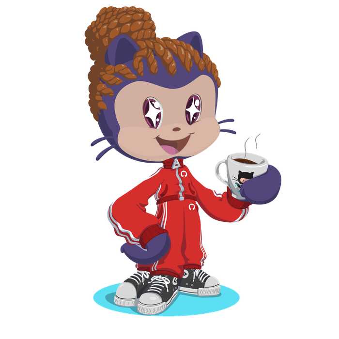

  

  

<table>
  <tr>
    <td valign="middle" width="60%">

### 👋 Olá, sou a Aline!

Recém-formada em **Análise e Desenvolvimento de Sistemas (FIAP)**, migrando da Fisioterapia para o desenvolvimento web. Da fisio eu trago disciplina, atenção a detalhes e experiência real com clientes — agora aplicando isso em código.

🔭 **No momento:** construindo landing pages como freelancer e me aprofundando em Power BI.

🛠️ **Stack:** HTML, CSS, JavaScript, Power BI (aprendendo), Java, SQL

💼 **Disponível para:** projetos freelance de landing pages e sites institucionais.

📌 Destaque: [Semear](https://github.com/AlineOCiriaco/Semear) — landing page para uma clínica multidisciplinar de saúde, no ar em [semear-seven.vercel.app](https://semear-seven.vercel.app).

📫 Contato: [LinkedIn](https://www.linkedin.com/in/aline-ciriaco/)

😄 Pronomes: ela/dela

⚡ Fã de animes e doramas — se você também curte o mundo geek, vamos conversar!

</td>
    <td valign="middle" align="center" width="40%">
      
    </td>
  </tr>
</table>

---

### 🧰 Tecnologias

  

---

### 📊 Estatísticas do GitHub

  
  

  

### 🏆 Troféus

  

  

